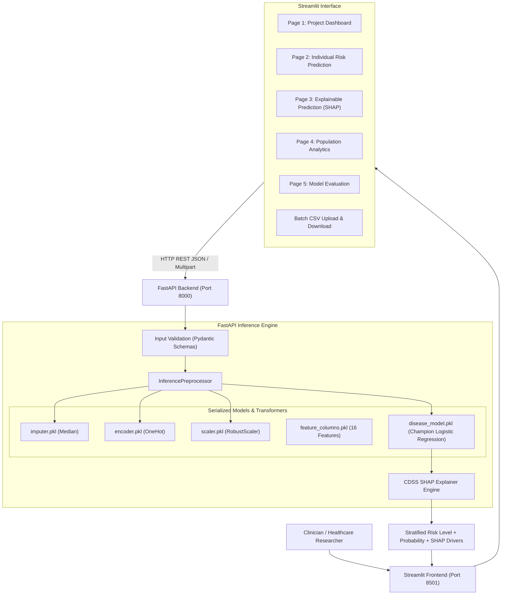

# Intelligent Healthcare Disease Risk Prediction & Clinical Decision Support System (CDSS)

> **Supervised Machine Learning System for Type 2 Diabetes Risk Prediction, Clinical Risk Stratification, and Explainable AI (SHAP).**  
> *Built with Python, Scikit-learn, XGBoost, SHAP, FastAPI, and Streamlit.*

---

## 1. Project Overview & Problem Statement

Early identification of patients at high risk of developing chronic diseases enables healthcare professionals to prioritize diagnostic workups and preventive interventions. Conventional machine learning projects often stop at binary classification; this project is engineered as a **Clinical Decision Support System (CDSS)** that answers three core clinical questions:

1. **What is the predicted outcome?** (Diabetic risk classification: High Risk vs. Low Risk)
2. **How confident is the model?** (Calibrated probability score and risk tier: High, Moderate, Low)
3. **Which patient factors contributed most to the prediction?** (Personalized Explainable AI breakdown using local SHAP contributions)

> **Clinical Disclaimer:** This application is developed as an educational clinical decision-support tool, not an autonomous medical diagnosis system.

---

## 2. System Architecture



---

## 3. Dataset & Data Quirk Handling

- **Source:** Pima Indians Diabetes Database (`data/diabetes_data.csv`).
- **Dimensions:** 768 patient instances, 8 clinical features, 1 binary target (`Outcome`: $0 = \text{Non-Diabetic}$, $1 = \text{Diabetic}$).
- **Target Class Balance:**
  - Non-Diabetic (Class 0): 500 patients (65.1%)
  - Diabetic (Class 1): 268 patients (34.9%)
  - Imbalance Ratio: $1.87 : 1$

### Known Physiological Quirk: Zeros as Missing Placeholders
In physiological context, values of `0` are impossible for living humans across several attributes. In this dataset, `0` was used as a missing value sentinel:
- **Insulin:** 374 zeros (**48.70%** missing)
- **SkinThickness:** 227 zeros (**29.56%** missing)
- **BloodPressure:** 35 zeros (**4.56%** missing)
- **BMI:** 11 zeros (**1.43%** missing)
- **Glucose:** 5 zeros (**0.65%** missing)

*Impact:* When zeros were masked as `NaN`, correlation with diabetes risk jumped from $0.13 \to 0.30$ for Insulin and $0.07 \to 0.26$ for Skin Thickness, uncovering hidden predictive signals.

---

## 4. Preprocessing & Feature Engineering Pipeline

Implemented in `training/preprocessing.py` and surfaced in `backend/preprocessing.py`:
1. **0-Value Masking:** Biologically impossible zeros converted to `np.nan`.
2. **Median Imputation (`SimpleImputer`):** Robust against extreme skewness in insulin and triceps thickness.
3. **Feature Engineering:**
   - **`BMI_Category`:** Derived WHO clinical tiers (`Underweight`, `Normal`, `Overweight`, `Obese`).
   - **`Age_Group`:** Derived age cohorts (`Young` [<30], `Middle_Age` [30–50], `Senior` [>50]).
   - **`Risk_Factor_Score`:** Composite integer count summing 5 ADA risk flags (Glucose $\ge 140$, BMI $\ge 30$, BP $\ge 80$, Age $\ge 45$, DPF $\ge 0.5$).
4. **Categorical Encoding:** `OneHotEncoder(handle_unknown='ignore')`.
5. **Feature Scaling:** `RobustScaler` (median & IQR scaling) to resist distortion from outliers.
6. **Class Imbalance Handling:** Stratified 80/20 train/test split. **SMOTE** applied strictly to the training split ($400/214 \to 400/400$), keeping the test set ($100/54$) pristine with zero data leakage.

---

## 5. Model Comparison Leaderboard & Viva Discussion

Benchmarked across 6 supervised algorithms using Stratified 5-Fold Cross-Validation and evaluated on the independent test set (154 patients):

| Model | ROC-AUC | Recall (Sensitivity) | Specificity | Precision | F1-Score | Accuracy | False Negatives | False Positives |
| :--- | :---: | :---: | :---: | :---: | :---: | :---: | :---: | :---: |
| **Logistic Regression (Champion)** | **0.8285** | **0.7407** | **0.7600** | **0.6250** | **0.6780** | **0.7532** | **14** | **24** |
| **Tuned Random Forest** | 0.8273 | 0.7037 | 0.7800 | 0.6333 | 0.6667 | 0.7532 | 16 | 22 |
| **Random Forest (Baseline)** | 0.8214 | 0.7407 | 0.7700 | 0.6349 | 0.6838 | 0.7597 | 14 | 23 |
| **Gradient Boosting (Baseline)** | 0.8196 | 0.7407 | 0.7700 | 0.6349 | 0.6838 | 0.7597 | 14 | 23 |
| **Tuned Gradient Boosting** | 0.8167 | 0.6852 | 0.7700 | 0.6167 | 0.6491 | 0.7403 | 17 | 23 |
| **XGBoost (Baseline)** | 0.8126 | 0.6667 | 0.8000 | 0.6429 | 0.6545 | 0.7532 | 18 | 20 |
| **Tuned XGBoost** | 0.8093 | 0.6852 | 0.7700 | 0.6167 | 0.6491 | 0.7403 | 17 | 23 |
| **Support Vector Machine (SVM)** | 0.7889 | 0.6481 | 0.7300 | 0.5645 | 0.6034 | 0.7013 | 19 | 27 |
| **Decision Tree** | 0.7041 | 0.6481 | 0.7600 | 0.5932 | 0.6195 | 0.7208 | 19 | 24 |

### Clinical Trade-Off (False Negatives vs False Positives):
- **False Negative (Critical Error):** Failing to identify an at-risk diabetic patient leads to untreated hyperglycemia and irreversible microvascular/macrovascular damage.
- **False Positive (Manageable Overhead):** Advising a healthy patient to undergo a confirmatory blood test (HbA1c / OGTT) causes minimal inconvenience and zero physical harm.
- **Decision:** **Logistic Regression** was selected as the deployment champion because it maximized ROC-AUC ($0.8285$) and achieved the lowest False Negatives ($14$ out of $54$).

---

## 6. Explainable AI with SHAP

The CDSS integrates SHAP (`utils/explainability.py`) into every inference call:
- **Increasing Risk Factors ($\uparrow$):** Identifies specific physiological variables elevating patient risk (e.g. Glucose > 140 mg/dL, elevated BMI, positive family history).
- **Reducing Risk Factors ($\downarrow$):** Highlights protective physiological readings (e.g. normal blood pressure, young age cohort).
- **Waterfall & Bar Plots:** Real-time visual explanation rendered via Plotly on Page 3.

---

## 7. Project Structure

```
disease-prediction/
├── backend/
│   ├── __init__.py
│   ├── app.py                 # FastAPI application & REST endpoints
│   ├── predictor.py           # Singleton inference engine & SHAP calculator
│   ├── preprocessing.py       # InferencePreprocessor
│   └── schemas.py             # Pydantic validation models
├── data/
│   ├── dataset.csv            # Original raw reference
│   ├── diabetes_data.csv      # Formatted 768x9 benchmark dataset
│   └── download_data.py       # Automated dataset downloader
├── frontend/
│   └── streamlit_app.py       # 5-Page Streamlit clinical UI
├── models/
│   ├── disease_model.pkl      # Serialized champion model
│   ├── encoder.pkl            # OneHotEncoder artifact
│   ├── feature_columns.pkl    # 16-feature schema list
│   ├── imputer.pkl            # SimpleImputer artifact
│   ├── model_info.json        # Governance metadata & test metrics
│   └── scaler.pkl             # RobustScaler artifact
├── notebooks/
│   ├── 01_EDA.ipynb           # Complete Exploratory Data Analysis
│   └── 02_Model_Training.ipynb# Model training, tuning, and benchmarking
├── outputs/
│   └── model_comparison_leaderboard.csv
├── training/
│   ├── __init__.py
│   ├── evaluate.py            # Clinical metrics & curve calculators
│   ├── model_selection.py     # Algorithm definitions & GridSearchCV
│   ├── preprocessing.py       # Data preparation, SMOTE & artifact export
│   └── train.py               # End-to-end training pipeline
├── utils/
│   ├── __init__.py
│   ├── explainability.py      # SHAP engine for individual/global explanations
│   ├── validation.py          # Physiological range validation & alerts
│   └── visualization.py       # Plotly ROC, PR, Confusion Matrix, SHAP plots
├── .gitignore
├── PROJECT_STATE.md           # Single source of truth & decisions log
├── README.md                  # System documentation
└── requirements.txt           # Core dependencies
```

---

## 8. How to Run

### 1. Installation
```bash
# Clone and navigate to repository
cd "disease prediction"

# Install core stack
pip install -r requirements.txt
```

### 2. Run the FastAPI Backend
```bash
uvicorn backend.app:app --host 0.0.0.0 --port 8000 --reload
```
Interactive Swagger API documentation will be accessible at:  
👉 **`http://127.0.0.1:8000/docs`**

### 3. Run the Streamlit Frontend
```bash
streamlit run frontend/streamlit_app.py
```
Access the clinical interface in your browser at:  
👉 **`http://localhost:8501`**

### 4. Retrain Models (Optional)
```bash
python3 training/train.py
```

---

## 9. API Reference

| Method | Endpoint | Description |
| :--- | :--- | :--- |
| `GET` | `/health` | Verifies service health and loaded model status |
| `GET` | `/model-info` | Returns algorithm metadata, training date, and benchmark metrics |
| `POST` | `/predict` | Predicts single-patient risk probability, risk category, and SHAP drivers |
| `POST` | `/batch-predict` | Accepts CSV file upload and returns cohort predictions or downloadable CSV |

### Sample `POST /predict` Request:
```json
{
  "age": 45,
  "bmi": 29.5,
  "glucose": 145,
  "blood_pressure": 88,
  "insulin": 120
}
```

### Sample Response:
```json
{
  "prediction": "HIGH_RISK",
  "probability": 0.6693,
  "risk_level": "HIGH",
  "risk_percentage": 66.9,
  "confidence_description": "Model indicates high confidence of elevated risk (66.9% estimated risk).",
  "clinical_recommendation": "Priority medical follow-up recommended: Schedule confirmatory diagnostic testing (Fasting Plasma Glucose and laboratory HbA1c).",
  "increasing_factors": [
    {"feature": "Glucose", "display_name": "Glucose", "shap_value": 0.9712, "direction": "INCREASE_RISK"},
    {"feature": "Risk_Factor_Score", "display_name": "Risk Factor Score", "shap_value": 0.3471, "direction": "INCREASE_RISK"}
  ],
  "reducing_factors": [
    {"feature": "BMI", "display_name": "BMI", "shap_value": -0.2271, "direction": "REDUCE_RISK"}
  ]
}
```

---

## 10. Limitations & Future Scope

### Limitations:
1. **Demographic Homogeneity:** The Pima Indians dataset represents a specific demographic cohort with high genetic susceptibility; generalization across diverse ethnic populations requires external validation.
2. **Missing Clinical Biomarkers:** Key diagnostic indicators like HbA1c and lipid profiles (HDL/LDL/triglycerides) were unavailable in this historic dataset.
3. **High Missingness in Insulin:** 48.7% missingness in 2-hour serum insulin required statistical imputation.

### Future Scope:
1. **Integration with EHR Systems:** Implementing HL7/FHIR API standards to ingest live electronic health record streams.
2. **Multimodal Diagnostics:** Incorporating wearable continuous glucose monitor (CGM) telemetry and dietary lifestyle logs.
3. **Model Continuous Learning:** Implementing drift detection (Evidently AI) and automated retraining pipelines for deployed clinical endpoints.

---

## 11. Production Cloud Deployment Guide

The system is configured for a two-tier cloud architecture:
```text
GitHub
   │
   ├── Backend (FastAPI)   → Deployed to Render.com Web Service
   │
   └── Frontend (Streamlit) → Deployed to Streamlit Community Cloud
```

### A. Local Setup (Virtual Environment)
```bash
# 1. Create and activate virtual environment
python3 -m venv .venv
source .venv/bin/activate  # On Windows: .venv\Scripts\activate

# 2. Install frozen dependencies
pip install -r requirements.txt

# 3. Launch FastAPI backend
uvicorn backend.app:app --host 0.0.0.0 --port 8000

# 4. Launch Streamlit frontend (in a second terminal)
streamlit run frontend/streamlit_app.py
```

### B. Deploying Backend to Render.com
1. Push your repository to GitHub.
2. Log into [Render.com](https://render.com) and click **New +** > **Web Service** (or use **Blueprint** with [`render.yaml`](file:///Users/vaishnavi/Programming/AIML_TNS_Trainig/disease%20prediction/render.yaml)).
3. Connect your GitHub repository.
4. Set the following configuration:
   - **Environment:** `Python 3`
   - **Build Command:** `pip install -r requirements.txt`
   - **Start Command:** `uvicorn backend.app:app --host 0.0.0.0 --port $PORT`
   - **Plan:** `Free`
5. Click **Deploy Web Service**.
6. Once deployed, verify your live API:
   - `https://<your-render-service>.onrender.com/health`
   - `https://<your-render-service>.onrender.com/docs`
7. Copy your Render backend URL.

### C. Deploying Frontend to Streamlit Community Cloud
1. Log into [share.streamlit.io](https://share.streamlit.io) with GitHub.
2. Click **New app**.
3. Select your repository, set branch to `main`.
4. Set **Main file path** to:
   ```text
   frontend/streamlit_app.py
   ```
5. Click **Advanced settings...** and add the environment variable under **Secrets** or **Environment variables**:
   ```toml
   API_URL = "https://<your-render-service>.onrender.com"
   ```
6. Click **Deploy!**
7. The Streamlit dashboard will launch live. If the backend URL is omitted, the frontend automatically falls back to the in-memory predictor so the app is never broken.
